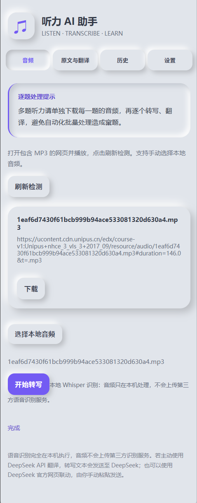
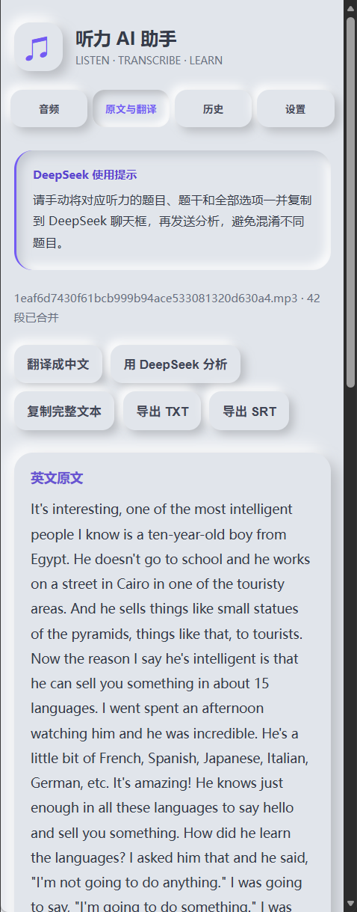

<h1 align="center">🎧 Listening Assistant · 听力 AI 助手</h1>

<p align="center">把网页音频变成看得懂、带得走的英语学习材料。<br>本地转写 · 中英翻译 · 智能答疑 · 新拟物侧边栏</p>

<p align="center">
  
  
  
  
  
</p>

<p align="center">
  <a href="https://github.com/LLLimit/ListeningAssistant/releases/latest"><strong>下载完整扩展包</strong></a> ·
  <a href="#安装">安装教程</a> ·
  <a href="#使用方法">使用方法</a> ·
  <a href="#开发与构建">开发构建</a> ·
  <a href="https://github.com/LLLimit/ListeningAssistant/issues">反馈问题</a>
</p>

---

面向英语学习者的浏览器扩展。检测网页音频，使用浏览器内的 Whisper 转写英语，再通过 DeepSeek 翻译和分析听力内容。无需安装 Python，也无需单独启动后台服务。

## 界面预览

<p align="center">
  
  
</p>

<p align="center"><sub>音频检测与本地转写 / 连续原文与学习工具。截图由作者提供。</sub></p>

## 功能亮点

| 功能 | 说明 |
| --- | --- |
| 🎵 网页音频 | 检测可识别的音频请求，下载 MP3 等文件；也可手动导入本地音频 |
| 🎙️ 本地转写 | Transformers.js + ONNX Runtime Web，在浏览器中运行 Whisper，使用 WebGPU |
| 🌏 中英对照 | 连续展示英文原文和中文翻译，一键复制完整双语内容 |
| 💬 DeepSeek 联动 | 复制原文与分析指令并打开官方网页；可选 API Key 自动翻译 |
| 🗂️ 历史与导出 | 本地保存最近 100 条记录，导出 TXT / SRT |
| ☁️ 新拟物界面 | 浅灰底色、柔和阴影、立体按钮与侧边栏分区 |

## 安装

1. 前往 [Releases](https://github.com/LLLimit/ListeningAssistant/releases/latest)，下载 **`ListeningAssistant-3.1.0-EdgeChrome.zip`**。
2. 解压到固定目录，保留完整文件夹。
3. 打开 `edge://extensions` 或 `chrome://extensions`，开启「开发人员模式」。
4. 点击「加载解压缩的扩展」，选择**直接包含 `manifest.json` 的目录**。本发行 ZIP 解压后的根目录就是扩展目录。
5. 点击工具栏中的扩展图标，打开听力助手侧边栏。

> 请下载 Release 中的完整 ZIP。GitHub 自动生成的 Source code 包面向开发者，不包含运行依赖与模型权重，不能直接作为完整安装包。

当前识别后端使用 WebGPU，需要浏览器与显卡支持并开启硬件加速；没有实现自动切换到 WASM CPU 的回退流程。建议使用新版 Edge / Chrome。

## 使用方法

### 1. 准备音频

打开听力网页并播放音频，在助手「音频」页点击「刷新检测」，下载对应文件。也可点击「选择本地音频」导入已有文件。

**建议每道听力单独下载、转写和翻译**，避免多个题目的内容混在一起。

### 2. 本地转写

在「设置」选择 Whisper 模型，然后返回「音频」，选择文件并点击「开始转写」。

| 模型 | 语言 | 获取方式 |
| --- | --- | --- |
| Whisper Tiny English | 英语 | 本发行包已包含量化权重，默认从扩展目录加载 |
| Whisper Base English | 英语 | 首次使用联网下载，之后使用浏览器缓存 |
| Whisper Tiny Multilingual | 多语言 | 首次使用联网下载，之后使用浏览器缓存 |

已检查发行包包含默认模型的编码器、解码器、配置和 tokenizer 文件；这不代表已完成所有设备上的推理验证。可选模型的离线可用性取决于下载是否完整及缓存是否保留。

### 3. 翻译与答疑

- **API 翻译：**在设置中填写 DeepSeek API Key，转写后进入「原文与翻译」，点击「翻译成中文」。API 使用可能产生费用。
- **官方网页：**点击「用 DeepSeek 分析」，扩展会复制原文和提示词并打开 DeepSeek 网页。手动粘贴，补充题目后发送；无需配置 API Key。

> 分析听力题时，请把**对应的题干和全部选项**一并粘贴到 DeepSeek 聊天框。扩展不会自动获取试题，也不会自动发送网页消息。

### 4. 保存结果

在「历史」查看此前记录，或在结果页复制完整文本、导出 TXT 与 SRT。SRT 使用模型生成的时间戳，必要时请自行校对。

## 隐私与权限

- 本地 Whisper 在浏览器内处理音频，不调用第三方语音识别服务；3.1.0 移除了 Groq 云端识别。
- DeepSeek API 翻译会将转写文本发送到 DeepSeek；网页版联动由用户手动粘贴并发送。
- 不需要 DeepSeek 账号 Cookie，不会自动读取其登录信息。
- API Key、设置和历史记录通过 `chrome.storage.local` 保存在当前浏览器中；清理扩展数据或卸载前请先导出重要文本。
- 模型下载会访问 Hugging Face。网页音频的原始请求仍由网站与浏览器处理。

| 权限 | 用途 |
| --- | --- |
| `webRequest`、`<all_urls>` | 观察网页中可识别的音频请求 |
| `downloads` | 下载检测到的音频 |
| `tabs` | 获取当前标签页并打开 DeepSeek 网页 |
| `sidePanel` | 展示助手侧边栏 |
| `storage` | 保存设置、API Key 和历史记录 |

当前 manifest 还保留了 `127.0.0.1:8765` 的旧权限声明；本地 Whisper 流程无需启动该地址上的服务。

## 常见问题

**为什么检测不到音频？** 部分网站使用 Blob、MediaSource、动态鉴权或流媒体地址，并不暴露可直接下载的 MP3，无法保证兼容所有网站。

**需要联网吗？** 完整发行包已带默认 Tiny English 模型与运行依赖；可选模型首次下载和 DeepSeek 翻译、网页答疑需要联网。

**为什么转写慢或失败？** 音频长度、模型大小、显存、WebGPU 支持和浏览器资源占用都会影响结果。请先尝试默认轻量模型并检查硬件加速。

**没有 API Key 可以用吗？** 可以，本地转写与导出不需要 Key；翻译和答疑可使用 DeepSeek 官方网页手动完成。

## 开发与构建

用户安装无需 Node.js；以下命令仅供开发者使用。

```powershell
npm ci
npm run prepare-model
npm run build
.\pack-extension.ps1
```

`prepare-model` 从 Hugging Face 下载默认模型；`build` 打包 Transformers.js 并复制 ONNX Runtime 资源；打包脚本生成可加载的扩展 ZIP。构建完成后加载 `extension/` 目录。

| 路径 | 内容 |
| --- | --- |
| `extension/background.js` | 音频请求检测与侧边栏入口 |
| `extension/panel.*`、`style.css` | 界面、翻译、历史及导出 |
| `extension/local-worker.js` | 本地 Whisper 推理 Worker |
| `download-default-model.mjs` | 默认模型下载 |
| `build.mjs` | 浏览器运行依赖构建 |
| `pack-extension.ps1` | 完整扩展打包 |
| `docs/images/` | 作者提供的界面截图 |
| `licenses/` | 第三方许可与模型来源 |

技术栈：Manifest V3 · JavaScript · HTML/CSS · Transformers.js · ONNX Runtime Web · WebGPU · Whisper · DeepSeek API。

## 版本与后续计划

当前版本 **3.1.0**：以本地识别为核心，保留 DeepSeek 翻译与官方网页联动。

- [x] 网页音频检测、下载与本地文件导入
- [x] 本地 Whisper / WebGPU 转写与模型选择
- [x] 连续原文、中英翻译、历史和 TXT / SRT 导出
- [x] DeepSeek 网页联动与移除 Groq 识别
- [ ] 更多设备和网站的兼容性验证
- [ ] 更多模型支持与无 WebGPU 设备回退

发布检查覆盖源码语法、包结构和关键资源存在性；本次发布整理未重新进行浏览器端到端识别、API 翻译或多设备实测。

## 许可与反馈

项目自身尚未指定开源许可证。公开仓库不等于授予任意复制、修改或再分发许可；第三方组件与模型遵循各自许可证，见 [第三方说明](THIRD_PARTY_NOTICES.md)。

欢迎通过 [Issues](https://github.com/LLLimit/ListeningAssistant/issues) 反馈 Bug、兼容性问题与功能建议，或提交 Pull Request。

<p align="center"><strong>Make Listening Easier with Local AI.</strong></p>
